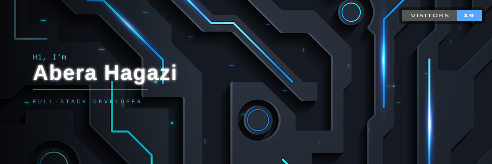

### 🧑‍💻 About Me
I'm a Full-Stack Developer who loves building secure, scalable and fast Web and Mobile apps everything from database design to pixel-perfect UIs on web and mobile. I enjoy crafting backends that are solid and secure, while building frontends that people actually find enjoyable to use. I care a lot about good UI, UX, security, and performance. Always learning, always picking up new frameworks, patterns, and challenges along the way.  
Contact Me:

&nbsp;&nbsp;
&nbsp;&nbsp;
&nbsp;&nbsp;
&nbsp;&nbsp;

## 🛠️ Tech Stack

  Languages
 

  
  
  
  
  
  
  

  Frameworks & Libraries
 

  
  
  
  
  
  

  Databases
 

  
  
  

  Tools & DevOps
 

  
  
  
  
  

## 📊 GitHub Stats

  
  

  

## 📈 Contribution Snake

  

## 🔭 Currently Working On / Learning

<table>
<tr>
<td valign="top" width="40%">

### 🚀 Currently Building
- 🛒 High-performance e-commerce websites and inventory management software
- 🛠️ Developer tools that simplify workflows and improve productivity
- 🤖 AI agent skills to automate and streamline development tasks
- 🌍 Open-source projects 

</td>
<td valign="top" width="50%">

### 📚 Currently Learning
- 🔐 Cybersecurity, focusing on system vulnerabilities, network security, and application security

</td>
</tr>
</table>

## 🤝 Connect With Me

&nbsp;&nbsp;
&nbsp;&nbsp;
&nbsp;&nbsp;
&nbsp;&nbsp;

**⭐️ Thanks for stopping by — if something here caught your eye, drop a star on a repo!**

