# Hero banner concepts

The profile currently uses **Floating developer workspace**. All three are self-contained SVG illustrations with gentle animation, static readable text, and a reduced-motion preference. Depth is illustrated with perspective, shading, and shadows; these are not interactive 3D scenes.

## 1. Floating developer workspace — active

## 2. Sculpted AB monogram

## 3. Isometric commerce world

To switch, change the first image source in the root README to `./assets/banners/monogram.svg` or `./assets/banners/commerce.svg`.

Open `preview.html` in a browser to compare the animations. GitHub image rendering may differ from a local browser; every banner has a complete static composition.
